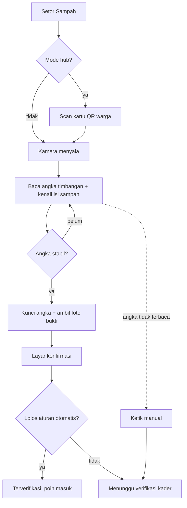

# Rancangan Aplikasi GASUKOM Digital (APK)

Dokumen ini menjadi acuan saat membangun APK. Isinya masih rancangan. Bagian yang bertanda **(usulan)** boleh diubah setelah dibahas.

## 1. Tujuan dan ruang lingkup

**Tujuan:** setiap setoran sampah organik tercatat lengkap dengan buktinya, yaitu berat dari timbangan, foto, jenis sampah, waktu, dan nama penyetor. Setoran itu lalu diubah menjadi poin dan peringkat supaya warga semangat.

**Masuk versi pertama (MVP):**
- Kamera membaca angka timbangan dan menguncinya saat angka stabil.
- Isi sampah dideteksi dari kamera yang sama (organik, atau ada sampah non-organik).
- Layar konfirmasi, foto bukti, dan riwayat setoran.
- Poin dan leaderboard untuk tingkat rumah tangga, RT, RW, dan kampung, dengan periode minggu ini, bulan ini, dan sepanjang waktu.
- Mode individu dan mode hub.
- Peran kader: memverifikasi setoran, mendaftarkan warga, dan mencetak kartu QR.
- Tetap jalan **tanpa internet** (data disimpan di HP), lalu sinkron ke Supabase saat ada sinyal.

**Belum masuk (tahap lanjut):** timbangan Bluetooth, dashboard web, model AI hasil latihan sendiri, tantangan dan badge lengkap, peta kampung, dan versi iOS.

## 2. Keputusan desain

| Keputusan | Pilihan | Alasan |
|---|---|---|
| Sumber berat | Kamera membaca layar timbangan (OCR) | Sesuai permintaan awal. Timbangan digital biasa langsung bisa dipakai tanpa harus merakit alat. Timbangan Bluetooth menyusul sebagai peningkatan. |
| Peran AI | Mengenali isi sampah, **bukan** menebak berat | Berat yang ditebak dari foto tidak akurat (sudah disepakati dalam diskusi) |
| Platform | Android native: Kotlin + Jetpack Compose | Kamera dan ML Kit paling andal di native, dan targetnya memang APK Android. Diskusi awal menyarankan Flutter, tetapi pembacaan angka langsung dari kamera lebih mudah dikendalikan di native. |
| AI di perangkat | ML Kit on-device | Gratis, jalan offline, tidak perlu kunci API |
| Server | Supabase (paket gratis) | Database, login, dan penyimpanan foto ada dalam satu layanan |
| Offline | Data disimpan dulu di HP (Room), sinkron belakangan | Sinyal di titik timbang bisa lemah |

## 3. Pengguna dan peran

| Peran | Yang bisa dilakukan |
|---|---|
| **Warga** | Setor sampah (mode individu), melihat riwayat, poin, dan leaderboard |
| **Kader** | Menjalankan mode hub, mendaftarkan warga dan mencetak kartu QR, memverifikasi setoran yang ditandai, mencatat poin kegiatan (edukasi/tantangan) |
| **Admin** (tim peneliti/pengelola) | Mengelola wilayah (kampung/RW/RT), akun kader, aturan poin, dan ekspor data |

## 4. Dua mode penggunaan

**Mode individu:** warga login di HP sendiri dan menimbang di rumah. Setoran otomatis tercatat atas nama rumah tangganya.

**Mode hub (titik timbang bersama):** satu HP dipasang di saung atau balai RW dan login sebagai kader. Untuk setiap warga yang datang:
1. Warga menunjukkan **kartu QR warga** (dicetak dari aplikasi), lalu HP memindai kartu itu.
2. Sampah ditaruh di timbangan, lalu alur kamera berjalan seperti biasa.
3. Setoran tercatat atas nama rumah tangga pemilik kartu, beserta keterangan titik hub dan kader yang bertugas.

Di mode hub, HP sebaiknya dipasang pada **dudukan tetap** yang mengarah ke timbangan. Posisi kamera jadi selalu sama sehingga angka lebih mudah terbaca.

## 5. Alur setoran



Peringatan sampah non-organik muncul langsung di layar kamera dan di layar konfirmasi. Warga bisa mengeluarkan sampahnya lalu menimbang ulang. Kalau tetap disimpan, setoran ditandai untuk diverifikasi kader.

## 6. Daftar layar

1. **Masuk / Daftar**: memilih mode (individu atau hub) lalu login.
2. **Beranda**: sapaan, total kg dan poin bulan ini, peringkat saat ini, tombol besar **Setor Sampah**, dan setoran terakhir.
3. **Kamera Timbang**: pratinjau kamera dengan **kotak panduan** untuk layar timbangan. Angka yang terbaca tampil langsung, disertai indikator stabil (lingkaran yang perlahan terisi) dan label isi sampah, misalnya "Sisa sayur · Kulit buah" atau "⚠ Terlihat plastik".
4. **Konfirmasi**: foto, berat dalam gram, jenis sampah (bisa dikoreksi), peringatan bila ada, perkiraan poin, serta tombol **Simpan**, **Ulangi**, dan **Ketik manual**.
5. **Riwayat**: daftar setoran beserta statusnya (terverifikasi, menunggu, atau ditolak).
6. **Leaderboard**: tab *Rumah Tangga · RT · RW · Kampung* dan pilihan periode *Minggu ini · Bulan ini · Sepanjang waktu*. Posisi pengguna sendiri disorot.
7. **Kader**: antrean verifikasi (foto dan angka, tombol Setujui/Tolak), daftar warga, tambah warga, cetak kartu QR, dan pencatatan poin kegiatan.
8. **Pengaturan**: nama tampilan atau samaran, **profil timbangan** (lihat 7.3), dan status sinkron.

Tampilan memakai huruf besar, kontras tinggi, dan kata-kata sederhana supaya nyaman bagi ibu rumah tangga dan lansia. Bahasa yang dipakai Bahasa Indonesia.

## 7. Membaca angka timbangan

### 7.1 Cara kerja

1. **CameraX** menampilkan pratinjau dan menganalisis frame (resolusi 1280×720) paling banyak 5 kali per detik. Hanya frame terbaru yang diproses.
2. Gambar **dipotong** sesuai kotak panduan supaya tulisan lain di sekitar timbangan tidak ikut terbaca. Potongan itu diperbesar bila kecil, lalu diubah menjadi abu-abu berkontras tinggi.
3. **ML Kit Text Recognition v2** (on-device) membaca teks dari potongan gambar itu.
4. **Parsing**: aplikasi mengambil pola angka (`0–9`, titik atau koma desimal) dan satuan (`g`/`kg`) bila terlihat, lalu mengubahnya ke gram berdasarkan profil timbangan. Huruf yang mirip angka 7-segmen (O→0, S→5, l→1, B→8, b→6, Z→2) dikembalikan menjadi angka.
5. **Stabilisasi**: angka dikunci bila nilai yang sama terbaca minimal 3 kali, bertahan ±0,6 detik, ≥70% bacaan sejak angka itu muncul bernilai sama, bacaan terakhir juga sama, nilainya minimal batas tertentu (misalnya 10 g), dan masih dalam kapasitas timbangan. Syaratnya berbasis waktu, jadi HP lambat tetap bisa mengunci.
6. Saat angka terkunci, **frame yang sedang dianalisis disimpan sebagai foto bukti** (JPEG, sisi terpanjang 1280 px). Foto ini memuat sampah sekaligus layar timbangan, jadi bisa diperiksa ulang oleh kader.

Implementasinya ada di `app/src/main/java/io/github/serfusion/gasukom/timbang/`: `PembacaAngka.kt` (parsing), `Penstabil.kt` (stabilisasi), dan `AnalisisTimbang.kt` (CameraX + ML Kit). Ketiganya punya unit test.

### 7.2 Risiko terbesar: angka 7-segmen

Layar timbangan memakai angka **7-segmen**. Pembaca teks umum seperti ML Kit sering salah membaca angka seperti ini. Contohnya 1 terbaca 7, 8 terbaca 0/6/9, titik desimal hilang, atau layar memantulkan cahaya. Cara mengatasinya:

- Pakai kotak panduan, potong gambar, dan naikkan kontras sebelum angka dibaca.
- Ambil kesepakatan dari beberapa frame, bukan dari sekali baca.
- Pakai **profil timbangan** supaya posisi desimal tidak perlu ditebak (lihat 7.3).
- **Uji dengan foto timbangan asli sejak awal** (tahap M1 di rencana kerja).
- Kalau hasilnya masih kurang akurat, buat **pembaca 7-segmen khusus**. Pembaca ini bisa berupa pengolahan citra yang mengecek segmen mana yang menyala, atau model kecil (TFLite) yang dilatih khusus untuk angka 7-segmen. Pilihan terakhir adalah beralih ke timbangan Bluetooth.

### 7.3 Profil timbangan (diatur sekali per HP atau titik timbang)

- Satuan yang tampil di layar: gram, atau kg dengan 1/2/3 angka desimal.
- Kapasitas maksimum dan resolusi, misalnya 5 kg / 1 g.
- Jenis layar: LCD (latar abu-abu, angka hitam) atau LED (angka menyala).

### 7.4 Rekomendasi timbangan (usulan)

- **Individu:** timbangan dapur digital 5 kg dengan resolusi 1 g, layar LCD berlampu latar, dan angka besar.
- **Hub:** timbangan duduk 30 kg dengan resolusi 5–10 g, layar besar, dan wadah setor standar yang sudah ditara.
- Hindari layar kecil yang mudah memantulkan cahaya. Sebaiknya semua titik memakai satu model timbangan yang sama supaya pembacaan mudah disetel.

## 8. Mengenali isi sampah

**MVP:** ML Kit Image Labeling (model dasar on-device dengan 447 label umum) dijalankan pada frame kamera yang sama, kira-kira setiap 0,8 detik. Labelnya dipetakan ke tiga kelompok (`klasifikasi/PemetaLabel.kt`):

- **Organik** (keyakinan ≥50%): Food, Fruit, Vegetable, Plant, Flower, Twig/Branch, Bread, Cake, Cuisine/Meal, Couscous (sering muncul untuk nasi), Coffee, Soil, Shell, dan sejenisnya.
- **Non-organik** (keyakinan ≥60%): Bag (kantong), Paper/Newspaper/Receipt (kertas), Cola/Juice (minuman kemasan), Wine/Alcohol (botol), Junk (sampah campur), Cutlery (sendok/garpu), Textile, Tire, Balloon, dan Toy.
- **Netral**: label lain, misalnya meja, tangan, wadah, atau timbangan. Kelompok ini diabaikan.

**Temuan saat implementasi:** model dasar ML Kit **tidak punya label "plastik" atau "botol"**. Kantong plastik hanya bisa tertangkap lewat label *Bag*, sedangkan kemasan lewat label minuman. Karena itu peringatan non-organik di MVP benar-benar hanya pengingat, dan model khusus di tahap lanjut menjadi penting. Pemetaan dan ambang di atas disetel ulang setelah diuji dengan foto asli.

Hasil deteksi berfungsi sebagai **pengingat**. Aplikasi menampilkan peringatan "Terlihat sampah non-organik, keluarkan dulu". Kalau warga tetap menyimpan, setoran ditandai untuk diverifikasi kader. Deteksi dari satu foto **tidak akan 100% tepat**, misalnya plastik kecil yang tertutup sayuran bisa terlewat. Karena itu foto bukti dan pemeriksaan kader tetap penting.

**Tahap lanjut:** melatih model khusus (TFLite) dengan kategori GASUKOM: sisa sayur, kulit buah, sisa makanan, daun kering, ampas kopi/teh, dan non-organik. Datanya berasal dari foto setoran yang dikumpulkan aplikasi atas izin warga, ditambah dataset publik yang lisensinya sesuai. ML Kit bisa memuat model khusus, jadi alur aplikasi tidak perlu diubah.

## 9. Poin dan leaderboard

**Poin berat (usulan):** `poin = berat_gram ÷ 10`, dibulatkan ke bawah. Rumus ini setara dengan 10 poin per 100 g, jadi 350 g menghasilkan 35 poin. Poin hanya dihitung dari setoran yang **terverifikasi**.

**Poin kegiatan (usulan):** setor 7 hari berturut-turut +50, ikut edukasi +30, menyelesaikan tantangan bulanan +100, dan mengajak rumah tangga baru yang aktif +50. Poin edukasi dan tantangan dicatat oleh kader. Semua nilai poin disimpan di tabel aturan, sehingga bisa diubah tanpa memperbarui aplikasi.

**Leaderboard:**

- Tingkatnya rumah tangga, RT, RW, dan kampung.
- Periodenya minggu ini (Senin–Minggu WIB), bulan ini, dan sepanjang waktu.
- Yang ditampilkan: peringkat, nama tampilan atau samaran, poin, dan total kg.
- Peringkat RT, RW, dan kampung **(usulan)** diurutkan berdasarkan **rata-rata poin per rumah tangga terdaftar**, supaya RT yang kecil tetap bisa bersaing. Total poin dan total kg tetap ditampilkan.

## 10. Aturan anti-curang

Setoran **otomatis terverifikasi** jika memenuhi semua syarat berikut. Batas angkanya masih **(usulan)**:

- Berat berasal dari kamera (OCR) yang terkunci stabil, bukan diketik.
- Tidak ada peringatan non-organik.
- Berat paling banyak 3 kg per setoran.
- Rumah tangga tersebut belum menyetor lebih dari 3 kali di hari yang sama.

Setoran yang tidak memenuhi syarat masuk ke status **menunggu verifikasi kader**, dan poinnya ditahan dulu. Pengaman lainnya:

- **Berat yang diketik manual** selalu berstatus "perlu verifikasi kader" dan baru mendapat poin setelah disetujui.
- **Foto bukti** wajib ada, memuat sampah dan layar timbangan.
- Setiap setoran punya **ID unik** yang dibuat di HP, sehingga sinkron berulang tidak membuat data dobel.
- Waktu, perangkat, mode, dan (di mode hub) kader yang bertugas ikut dicatat.
- Kader bisa **menolak** setoran dengan menuliskan alasannya, dan warga melihat statusnya di riwayat.

## 11. Data dan server

### 11.1 Struktur data (ringkas)

| Tabel | Isi utama |
|---|---|
| `wilayah_kampung`, `wilayah_rw`, `wilayah_rt` | Urutan wilayah kampung → RW → RT |
| `rumah_tangga` | id, rt_id, nama tampilan/samaran, kode kartu QR, status aktif |
| `profil` | user_id (akun Supabase), rumah_tangga_id, nama, peran (warga/kader/admin) |
| `titik_timbang` | id, nama (misalnya "Saung RW 05"), rw_id, profil timbangan |
| `setoran` | id (UUID dari HP), rumah_tangga_id, dicatat_oleh, titik_timbang_id/perangkat, mode, berat_gram, sumber_berat (ocr/manual/ble), jumlah frame yang cocok, label AI, ada_non_organik, foto_path, status, poin, diverifikasi_oleh, alasan_tolak, waktu_setor |
| `poin_kegiatan` | rumah_tangga_id, jenis (streak/edukasi/tantangan/ajak), poin, dicatat_oleh, waktu |
| `aturan_poin` | Nilai poin dan batas verifikasi yang bisa diubah |

Leaderboard dihitung oleh **fungsi SQL** `leaderboard(tingkat, periode)` di Supabase. HP hanya menerima hasil peringkat, bukan data mentah semua warga.

### 11.2 Keamanan (Row Level Security)

- Warga hanya bisa membaca dan menambah setoran rumah tangganya sendiri.
- Kader bisa mengubah status setoran di wilayahnya.
- Foto disimpan di *bucket* privat dan dibuka lewat tautan sementara.
- APK hanya berisi kunci publik (*publishable/anon key*). Kunci rahasia (*secret/service_role key*) tidak boleh masuk ke APK maupun repo.

### 11.3 Foto dan kuota gratis

Paket gratis Supabase membatasi kapasitas penyimpanan file, sekitar 1 GB saat dokumen ini ditulis (**cek ulang**). Hitungan kasar untuk pilot: 50 rumah tangga × 1 setoran per hari × 180 hari = **±9.000 foto**. Usulannya:

- Kompres foto bukti, misalnya lebar 1024 px dengan JPEG ±80–120 KB.
- Simpan *thumbnail*, lalu hapus foto asli beberapa bulan setelah setoran diverifikasi (**perlu diputuskan**).
- Proyek gratis bisa dijeda otomatis kalau lama tidak dipakai. Selama pilot berjalan hal ini tidak jadi masalah, tetapi ketentuannya tetap perlu dicek.

### 11.4 Offline dan sinkron

- Semua setoran disimpan dulu di **Room** (database di HP), lalu dikirim oleh **WorkManager** begitu ada internet.
- **Tahap pertama bisa berjalan tanpa server sama sekali.** Satu HP hub menyimpan data warga, setoran, poin, dan leaderboard secara lokal. Cara ini cocok untuk uji coba awal di satu titik.

## 12. Arsitektur aplikasi

Struktur paket di `app/src/main/java/io/github/serfusion/gasukom/` (✅ = sudah ada):

```
├─ ui/           ✅ Navigasi, tema, beranda, ikon
├─ timbang/      ✅ Kamera (CameraX), analisis frame + OCR, pembaca angka, penstabil,
│                   layar timbang, konfirmasi, pengaturan timbangan, aturan verifikasi
├─ klasifikasi/  ✅ Pemetaan label ML Kit ke organik/non-organik
├─ data/         ⬜ Room (lokal), repository, model data (M2)
├─ poin/         ⬜ Poin, streak, leaderboard (M2)
└─ sinkron/      ⬜ Klien Supabase dan WorkManager (M3)
```

Pustaka dan versi saat ini:

- Kotlin 2.2.21, Android Gradle Plugin 8.13.2, Gradle 8.14.3, compileSdk/targetSdk 36
- Jetpack Compose (BOM 2025.12.01, Material 3) dan Navigation Compose
- CameraX 1.5.2
- ML Kit Text Recognition v2 16.0.1 dan Image Labeling 17.0.9, versi *bundled* agar jalan offline
- DataStore untuk pengaturan timbangan
- Menyusul: ML Kit Barcode Scanning (kartu QR), Room, WorkManager, supabase-kt

Versi Android minimum adalah **Android 7.0 (API 24)**, supaya HP lama warga tetap bisa memakai aplikasinya.

Pembaca timbangan dan pengenal sampah dibuat sebagai komponen terpisah yang bisa diuji dengan **kumpulan foto contoh**. Dengan begitu akurasinya bisa diukur sebelum dipakai di lapangan.

## 13. Izin dan privasi

- Izin yang diminta hanya kamera, ditambah notifikasi bila nanti ada pengingat. Lokasi GPS tidak diperlukan.
- Saat mendaftar, warga membaca dan menyetujui penjelasan singkat: data apa yang disimpan, untuk apa fotonya, dan siapa yang bisa melihat.
- Leaderboard hanya menampilkan nama tampilan atau samaran dan RT/RW, tanpa alamat.
- Foto hanya dipakai untuk melatih AI jika warga menyetujuinya lewat pilihan terpisah.
- Pengguna di bawah umur memerlukan persetujuan wali.

## 14. Distribusi APK

- ✅ **GitHub Actions** (`.github/workflows/build-apk.yml`) menjalankan unit test dan membangun APK setiap kali ada perubahan. APK dari branch utama otomatis menggantikan isi pre-release **`build-terbaru`**, jadi link unduhnya selalu sama: <https://github.com/serfusion/Detector-Pilah-Sampah-Organik/releases/download/build-terbaru/gasukom-digital.apk>.
- APK yang dibagikan adalah build *release*: kode dirampingkan R8, pustaka native dikompres, dan hanya memuat ABI ARM (arm64-v8a, armeabi-v7a). Ukurannya ±22 MB, padahal tanpa langkah ini sekitar 56 MB.
- Untuk memasangnya, HP Android perlu mengizinkan "instal dari sumber tidak dikenal".
- Selama masa uji, APK ditandatangani dengan kunci debug yang dibuat ulang setiap build, jadi versi lama harus dihapus sebelum memasang versi baru.
- Untuk pilot, APK ditandatangani dengan **kunci rilis yang tetap**. Kunci ini disimpan sebagai *secret* di GitHub (`GASUKOM_KEYSTORE_BASE64`, `GASUKOM_KEYSTORE_PASSWORD`, `GASUKOM_KEY_ALIAS`, `GASUKOM_KEY_PASSWORD`), bukan di repo. Workflow otomatis memakainya begitu secret tersedia. Selama kuncinya sama, pembaruan bisa dipasang di atas versi lama tanpa menghapus data.

## 15. Tahap lanjut (setelah MVP)

- Timbangan Bluetooth (load cell + HX711 + ESP32 BLE) menjadi sumber berat utama, dan OCR tetap dipakai sebagai pemeriksa.
- Dashboard web untuk tim peneliti dan pengelola: tren, komposisi sampah, partisipasi per RT/RW, dan ekspor data.
- Model AI khusus GASUKOM.
- Tantangan berkala, badge, dan notifikasi pengingat.
- Estimasi dampak lingkungan, hanya memakai faktor konversi yang bersumber ilmiah.
- Peta partisipasi "Kampung Sirkular".
